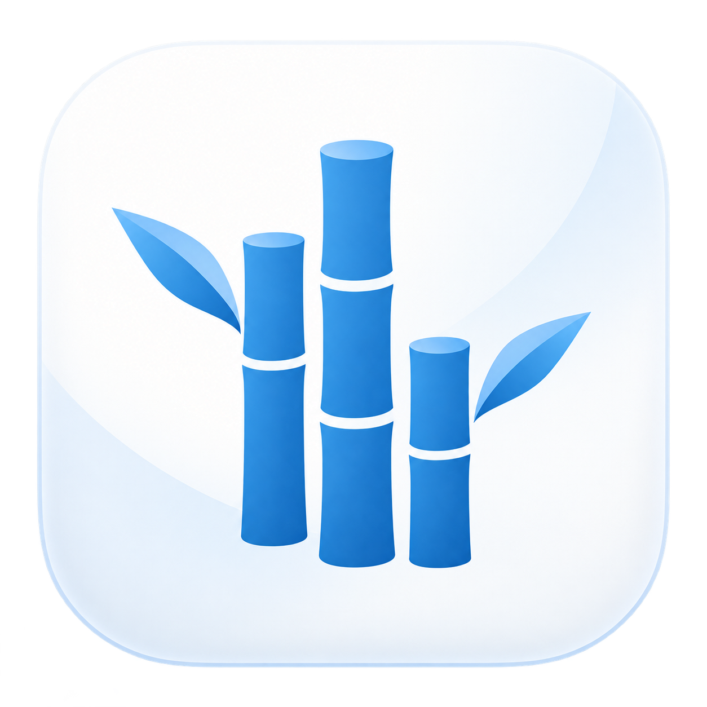

<div align="center">



# Bamboo

### Explore Parquet, locally and in the cloud.

**Your files. Your SQL. One workbench.**<br>
Browse local files, Amazon S3 and Cloudflare R2.<br>
Query with DuckDB, without importing your data into a database.


[](LICENSE)

**[Download](https://github.com/OldPanda/bamboo/releases/latest)** · **[Installation guide](docs/first-install.md)** · **[Website source & deployment](website/README.md)** · **[Documentation](#documentation)** · **[Contributing](CONTRIBUTING.md)** · **[Security](SECURITY.md)**

</div>

## Features

- **Explore files.** Preview rows, inspect schemas, sort and filter columns.
- **Query across files.** Write SQL with inline completion, joins and aggregations.
- **Connect your storage.** Open local folders, S3 or R2 workspaces; cloud credentials stay in macOS Keychain.
- **Pick up where you left off.** Keep multiple files open and restore saved query drafts.

## Quick start

Download the DMG from [GitHub Releases](https://github.com/OldPanda/bamboo/releases/latest), drag Bamboo into Applications, then open a Parquet file. See the [first-install guide](docs/first-install.md) if macOS blocks the first launch.

## Build from source

**1 · Build.** On an Apple Silicon Mac, install Xcode Command Line Tools,
Node.js 22.12+, Python 3.12+ and Go. From the repository root:

```sh
npm ci
npm run build
open build/Bamboo.app
```

The build downloads Go 1.27.3 as needed. Local builds are ad-hoc signed, not notarized.

**2 · Open data.** Choose a file, folder or cloud workspace, or drop a Parquet file into the welcome area.

**3 · Query.** Use `data` for the selected file, or `workspace."orders.parquet"` for a file in the active workspace.

## Documentation

[Cross-file SQL](WORKSPACE_SQL.md) · [Amazon S3](S3_WORKSPACES.md) · [Cloudflare R2](R2_WORKSPACES.md) · [Development and tests](CONTRIBUTING.md)

## License

[MIT](LICENSE). Built with [MyGo](https://github.com/egoist/mygo) and [DuckDB](https://duckdb.org/).
See [third-party notices](THIRD_PARTY.md) for dependency licenses.
